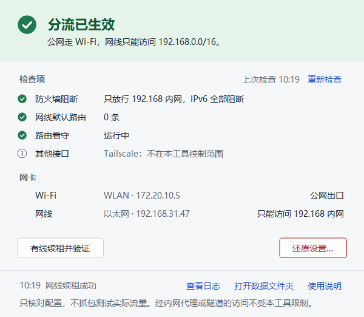
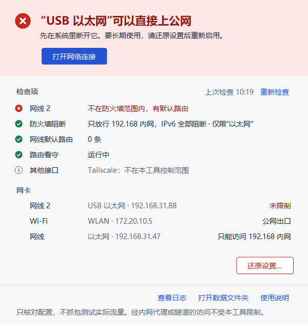
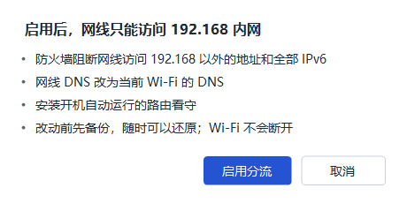

# wifi-lan-split · 双网分流

[简体中文](README.md) | **English**

[](https://github.com/50kg/wifi-lan-split/actions/workflows/ci.yml)
[](LICENSE)


For a Windows PC that is connected to **a phone hotspot over Wi-Fi** and **an office LAN cable** at the same time:

- Internet traffic goes only through Wi-Fi.
- The cable can reach only `192.168.0.0/16`.
- When Wi-Fi drops, the cable does not take over.

It is built on the Windows Firewall plus a tiny route guard. It installs no drivers and downloads nothing. Every change can be checked and undone.

<p align="center"></p>

> The interface is in Simplified Chinese. This README gives an English gloss of every label you need.

## Why

With two adapters online, Windows picks the outgoing interface by metric, and Internet traffic easily ends up on the office cable. The office network can then see, log or block that traffic, and some employers forbid using the office network for the Internet at all.

Tuning metrics by hand is not enough. A DHCP renewal on the office network adds the cable's default gateway back. And the moment Wi-Fi drops, Windows switches to the cable.

wifi-lan-split makes "the cable only reaches the LAN" a firewall rule. Routing only steers traffic to the right adapter, so even if the routing table is briefly wrong, the firewall still blocks it.

## What it does

| Layer | Role |
| --- | --- |
| Firewall (main protection) | On wired interfaces, blocks every IPv4 destination outside 192.168.0.0/16 and all of IPv6, for every app, protocol and port; DHCP broadcasts stay allowed. If the hotspot subnet is itself inside 192.168, it is blocked on the wired side too. |
| Routing | Wi-Fi gets the lower metric; the cable keeps only a route to 192.168.0.0/16 through the office gateway; the cable's DNS is switched to the Wi-Fi DNS. |
| Route guard | `RouteGuard.exe` runs as SYSTEM from boot, watches route changes through the Windows IP Helper API, and deletes default routes that DHCP adds back to the cable. |
| Backup and restore | Firewall and network settings are backed up before any change. Restore checks the adapter GUIDs and the Windows installation ID, so a backup is never applied to another machine. |

The window checks the state, read-only, every time it opens:

- the top line is the verdict;
- each check is listed below it with its current value, problems first;
- when the tool can fix a problem itself, the fix button sits right under the verdict.

<p align="center">
  
  
</p>

<sub>Screenshots use made-up data.</sub>

## Quick start

**Requirements**: Windows 10/11 64-bit with the built-in Windows PowerShell 5.1 and .NET Framework 4.x. Windows Firewall must be on.

1. Download the zip from [Releases](https://github.com/50kg/wifi-lan-split/releases). Extract **all** of it to a folder only administrators can write to, for example `C:\Program Files\双网分流`.
2. Connect the phone hotspot over Wi-Fi first, then plug in the office cable. The cable must get a 192.168.x.x address and gateway from DHCP.
3. Run `双网分流.exe` and accept the administrator prompt.
4. Click **启用分流…** (Enable split…). A confirmation dialog lists every change; nothing happens until you confirm.
5. After that, opening the window is enough to see the verdict. **还原设置…** (Restore settings…) puts every network setting back as it was before.

The program is not code-signed, so Windows SmartScreen may warn about an unknown publisher the first time. Compare the SHA-256 on the Release page, or [build it yourself](#build-from-source).

The full user guide is in [docs/en/user-guide.md](docs/en/user-guide.md).

### What the window says

| Colour | Example verdict | Meaning |
| --- | --- | --- |
| Green | 分流已生效 (Split in effect) | The cable reaches only 192.168; Internet goes through Wi-Fi. |
| Amber | 路由看守没有运行 (Route guard not running) | Something needs attention, but the cable is not exposed: the firewall still blocks it. |
| Red | 尚未启用分流 (Not enabled yet), "USB 以太网"可以直接上公网 ("USB Ethernet" can reach the Internet) | The cable may be able to reach the Internet. |

Buttons you may see:
- 修复路由看守: repair the route guard.
- 打开网络连接: open Network Connections.
- 有线续租并验证: renew the cable's DHCP lease and verify the guard.
- 重新检查: check again (F5).
- 查看日志: show the log.
- 打开数据文件夹: open the data folder.

## Security design

- **Checks are read-only**: opening the window, F5 and 重新检查 only read the configuration; they never change the network.
- **Verified backend**: the window runs as administrator, so it never executes the scripts in its own folder directly.
  - The SHA-256 of the three backend files is compiled into the exe.
  - Before each run they are verified, copied, and run from a folder that only SYSTEM and Administrators can write to.
  - A modified file is refused.
- **Protected data folder**: `C:\ProgramData\WifiLanSplit` is created locked to SYSTEM and Administrators. A folder that someone else created first is refused.
- **One change at a time**: enabling, repairing, renewing and restoring exclude each other. Closing the window does not interrupt a running change.
- **A guard you can trust**:
  - An update stages the new program first and puts the old one back if the swap fails; the boot task stays registered.
  - The heartbeat is written only after a successful pass, so "running" means it is really working.

Details are in [docs/en/architecture.md](docs/en/architecture.md).

## Limits

Please read this section before relying on the tool.

- **The firewall is the real protection.** The guard deletes a DHCP default route only after it appears; in between, the firewall does the blocking.
- **Indirect forwarding is not controlled.** Control is by destination address and adapter only. A server on the allowed 192.168 network that relays Internet traffic for you (a proxy or jump host) is out of reach.
- **Tunnels and virtual adapters are out of scope.** VPNs and tunnels such as Tailscale, VM bridges, WSL/Docker adapters and kernel drivers are listed in the window, but not managed.
- **Administrators can change anything.** Software with administrator rights or group policy can change these settings; this is not isolation against an administrator.
- **Office DNS names may stop resolving.** The cable now uses the hotspot's DNS; reach office services by IP.
- **What has been verified.** Disconnect-and-capture, DHCP renewal and reboot checks were done on the author's machine; see [docs/en/verification.md](docs/en/verification.md). Other hardware, other networks and a first install on a second machine have not been verified yet.

## Build from source

No network and no Visual Studio needed; the .NET Framework compiler that ships with Windows is enough:

```powershell
powershell -NoProfile -ExecutionPolicy Bypass -File .\build.ps1
```

Output goes to `dist/`. **Rebuild after changing `backend.ps1`, `network-core.ps1` or `RouteGuard.cs`.** Otherwise the window's integrity check fails and it refuses to run.

## Tests

```powershell
powershell -NoProfile -ExecutionPolicy Bypass -File .\tests\Run-Tests.ps1
```

`Run-Tests.ps1` runs:

- syntax and encoding checks;
- a build into a temp folder;
- isolated simulations of enable, restore, status and guard update;
- tests of the backend integrity check;
- a UI layout check at 100%–175% scaling, on this screen and on a simulated 1024×768 screen.

Every network, firewall and scheduled-task command is first replaced by a stub that throws, so a missing mock fails the test instead of touching the real system. The last two parts need an elevated PowerShell. GitHub Actions runs the suite on every push.

UI preview with made-up data (no backend is called):

```powershell
.\dist\双网分流.exe --preview .\build\preview
.\dist\双网分流.exe --preview .\build\preview-small --screen 1024x768
```

## Project layout

```text
src/native/        WinForms window (LanSplit.cs), route guard (RouteGuard.cs), application manifest
src/powershell/    backend.ps1 (check / enable / repair / renew / restore), network-core.ps1 (backup, firewall, routes, DNS), offline Restore.cmd
src/postboot/      optional one-time post-reboot check
tests/             isolated tests and the test runner
docs/              Chinese docs; docs/en/ holds the English versions
build.ps1          compiles and packages into dist/; installs and starts nothing
```

## Contributing

Issues and pull requests are welcome. Please read [CONTRIBUTING.md](CONTRIBUTING.md) first, and report security problems privately as described in [SECURITY.md](SECURITY.md).

## License

[MIT](LICENSE)
